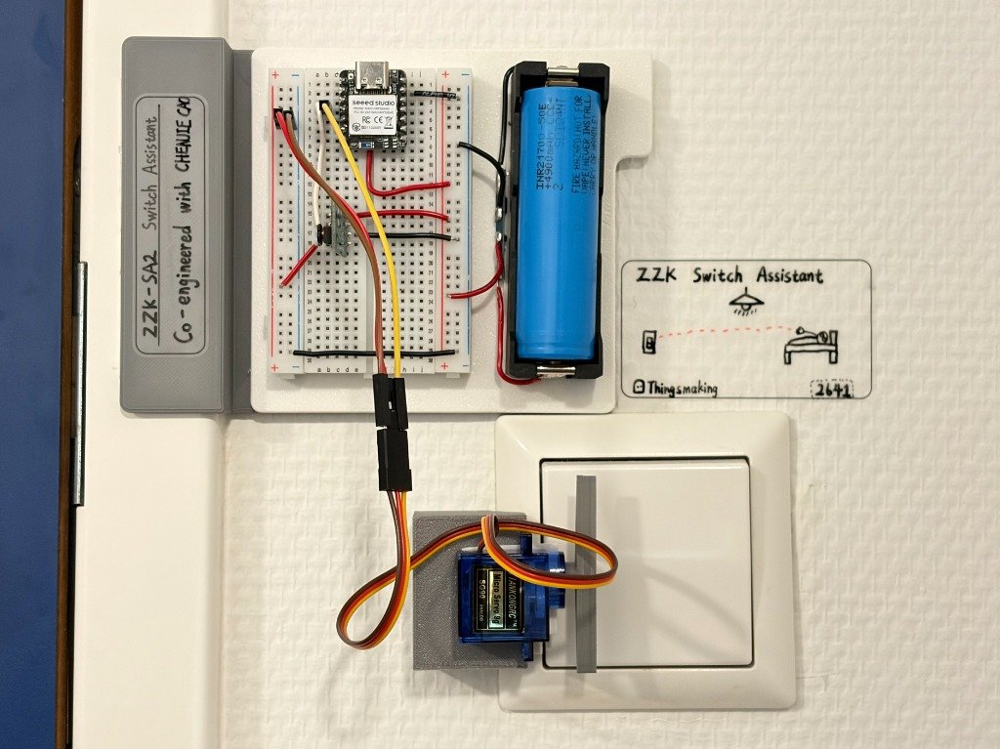
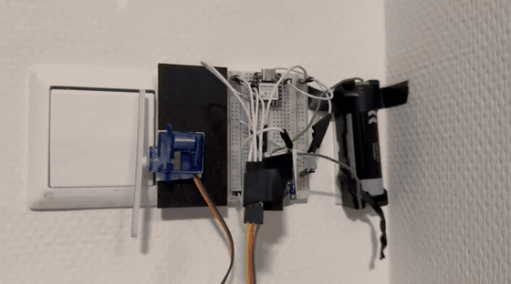
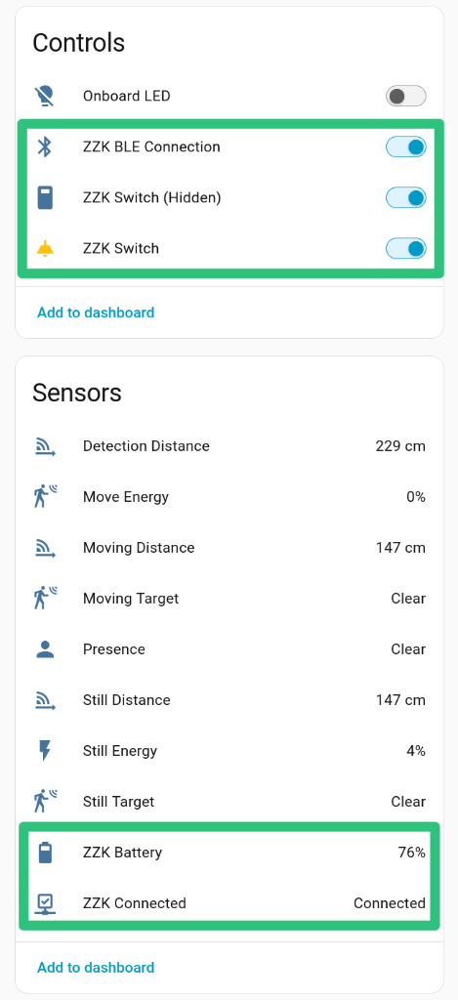
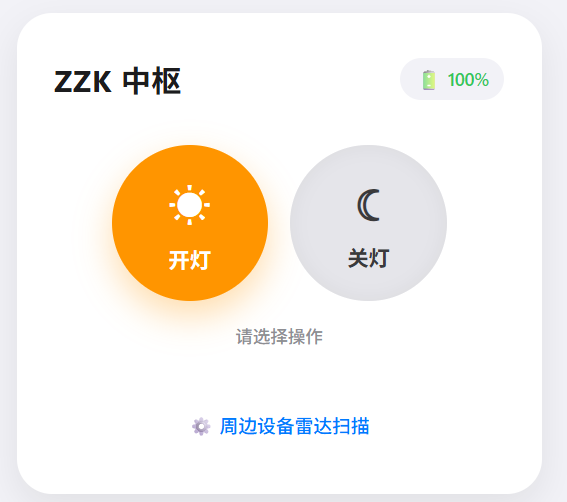
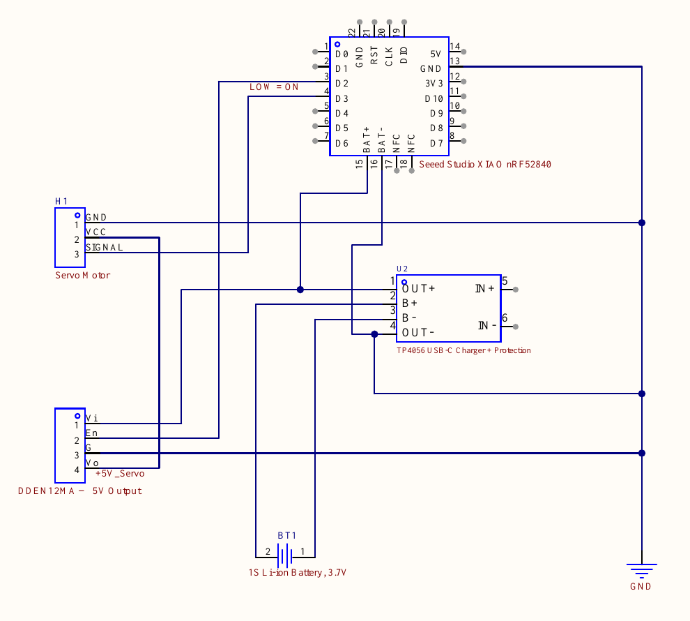

# ZZK Switch Assistant 2 (ZZK-SA2)

[English](README.md) | **中文**

[快速开始](#快速开始) · [硬件](#硬件) · [BLE 协议](#ble-协议) · [OTA 升级](#OTA 固件升级) · [已知限制](#已知限制)

> 从此关灯不必离开温暖的被窝~
>

ZZK-SA2 是电池供电的 BLE 无线执行器，可用舵机物理按压墙壁开关，为低功耗场景优化，支持接入 Home Assistant.



---

## 注意

这是一个实验性项目，可能仍存在很多问题。且你可能需要亲自修改或定制代码/硬件才能使它正常工作。

---

## 简介

ZZK-SA2 基于 Seeed Studio XIAO nRF52840，通过 BLE 接收指令驱动舵机按压墙壁开关，实现不改动房间原有电路的灯光远程控制。

如果你住在多人间学生宿舍，则关灯很可能需要从上铺爬下，非常不方便。即便是租住在单人公寓，房间的主灯也很可能只能通过门口唯一一个开关控制——这就是 ZZK-SA2 存在的意义。

设备本身只对外暴露一套 BLE GATT 接口，不绑定任何上层平台，接入方式可任意替换：我们推荐经由一块 ESP32 开发板通过 ESPHome 接入 Home Assistant；当然，你也可以选择使用 [CCJ Gateway](https://github.com/coauther/CCJ-Gateway)，或者使用任意支持发送 BLE 指令的设备/App.

### 为什么叫 ZZK？

ZZK 是本项目作者之一 CCJ 的室友。ZZK 总是比 CCJ 更晚休息，因而每天关灯的“重任”自然交给了 ZZK. ZZK Switch Assistant 的出现接替了 ZZK 关灯的工作，因而得名。

### ZZK-SA1 （第一代）到哪儿去了？

ZZK-SA 系列设计之初采用的是 ESP32 + ESPNOW 的通信/控制方案。但实际测试表明该方案的通用性不佳且功耗控制较为困难，电池续航时间短，不实用。故此方案已被废弃。

### 相较于其他“宿舍关灯神器”，ZZK-SA2 的优势是什么？

- 为低功耗场景做优化，电池续航时间长，工作时无须连接外部电源。
- 采用标准的 BLE 通信协议，方便接入你已有的系统。
- 支持 OTA 等现代化便捷的调试方式。
- 后续支持扩展更多家居自动化功能。

---

## 演示

### 开关灯动作演示



### 控制界面演示

#### 接入 ESPhome / Home Assistant

通过 ESPHome 网关接入后，ZZK 的开关实体、电池电量、连接状态及 OTA 维护模式开关可直接映射至 Home Assistant，并与现有传感器无缝共存：



#### CCJ Gateway Web 界面

若使用独立 ESP32 运行 CCJ Gateway，可通过浏览器访问本地 Web 页面进行开/关控制与电量监控：



---

## 硬件

### 物料清单

| 类别 | 型号 / 规格 | 数量 |
|---|---|---|
| 主控板 | Seeed Studio XIAO nRF52840 | 1 |
| 执行器 | SG90 迷你舵机 | 1 |
| 升压模块 | **带使能引脚 (EN)** 的 5V DCDC 升压模块 | 1 |
| 电池 | 3.7V 锂电池（需配置保护电路） | 1 |
| 结构件 | 定制 3D 打印件 | 1 套 |

### 引脚分配与接线

#### 外部接线

| 功能 | 引脚 | 电平 / 参数 |
|---|---|---|
| 升压模块使能 | `D2` | 低电平有效 (Active LOW) |
| 舵机控制信号 | `D3` | PWM (50 Hz) |
| 舵机供电 | — | 5V |
| 系统电源输入 | `BAT+` / `GND` | 3.3V ~ 4.2V |

完整接线原理图请参考工程文档

#### 板载电路

电池采样电路已完全集成在 Seeed Studio XIAO nRF52840 板载硬件中，无需外部接线（可参考 [Seeed 官方文档](https://wiki.seeedstudio.com/cn/XIAO_BLE/)）：
- `PIN_VBAT` (P0.31 / AIN7)：板载 1.5 MΩ（1000 kΩ + 510 kΩ）分压网络输入端。
- `PIN_VBAT_ENABLE` (P0.14)：板载分压电路使能引脚（Active LOW）。

---

## BLE 协议

### 广播参数与标识

| 参数 | 设定值 | 说明 |
|---|---|---|
| 设备名称 | `ZZK-SA2` | 于 Scan Response 中广播 |
| 广播间隔 | 200 ~ 1000 ms | 快速广播 200 ms，随后进入 1000 ms 慢速广播 |
| 发射功率 | 0 dBm | nRF52840 默认平衡发射功率 |
| 设备角色 | BLE Peripheral | 单从机模式，建立连接后停止广播，不支持多主机并发 |

### GATT 服务与特征值

| 服务 / 特征值 | UUID | 属性 | 数据格式 | 说明 |
|---|---|---|---|---|
| **Switch Service** | `2d220000-516b-47bd-a33b-2c93889ac9b7` | — | — | 自定义开关主服务 |
| └─ Switch Control | `2d220001-516b-47bd-a33b-2c93889ac9b7` | Write | `uint8` | 写入 `0x01` 开灯，`0x00` 关灯；单向写入无应答 |
| └─ Battery Level | `2d220002-516b-47bd-a33b-2c93889ac9b7` | Read, Notify | `uint8` | 电池剩余百分比 (`0~100`) |
| **DFU Service** | `0000fe59-0000-1000-8000-00805f9b34fb` | — | — | Nordic 官方 Secure DFU OTA 升级服务 |

两个自定义特征值的读写权限均为 Open，无需配对与链路加密。

### 电量采样与上报策略

- **采样与滤波**：配置 10-bit ADC 与 2.4V 内部参考基准，采用 8 次连续采样取均值滤波以消除电压波动。
- **电压映射区间**：根据板载分压电阻比例换算电池实际电压，按 3.3V (0%) ~ 4.2V (100%) 线性映射为百分比。
- **上报机制（双触发）**：
  - **连接即时推送**：主机连接并写入 CCCD 开启 Notify 时，固件触发回调立即上报一次当前电量，无需等待定时周期。
  - **周期性上报**：FreeRTOS 软件定时器每 5 分钟自动采样并更新上报一次。

---

## 低功耗设计

设备由单节 3.7V 锂电池供电。为满足数月以上的续航需求，固件在硬件外设和 FreeRTOS 调度层做了多级低功耗优化：

| 机制           | 配置 / 策略          | 说明                                                         |
| -------------- | -------------------- | ------------------------------------------------------------ |
| 舵机动态供电   | 硬件使能切断         | 平时拉高 `D2` 关闭 5V 升压输出，切断舵机与升压模块的待机静态漏电 |
| FreeRTOS 调度  | `suspendLoop()`      | 初始化完成后挂起主循环任务，不占用 CPU 轮询，完全转为事件驱动 |
| 定时任务       | FreeRTOS 软件定时器  | 仅在电量采集周期（默认 5 分钟）唤醒系统，采集完毕后系统重回睡眠 |
| 芯片供电模式   | 启用内部 DCDC 稳压器 | 置位 `NRF_POWER->DCDCEN`，相比默认 LDO 模式大幅降低待机与射频电流 |
| 未使用外设关闭 | 禁用 USB 控制器      | 清零 `NRF_USBD->ENABLE`，关闭 USB 模块时钟与内部检测         |
| 板载指示灯关闭 | 禁用所有板载 LED     | 强制拉高板载 RGB LED，并调用 `Bluefruit.autoConnLed(false)` 消除蓝牙状态闪烁指示 |

---

## 快速开始

### 依赖环境

- [PlatformIO Core](https://platformio.org/) 或 PlatformIO IDE（VS Code / CLion 插件）
- 平台分支：社区维护的 `maxgerhardt/platform-nordicnrf52`，板卡定义为 `xiaoble_adafruit`

### 硬件参数配置

项目采用了配置与代码解耦的设计。首次克隆仓库后，需将示例配置文件复制一份：

```bash
cp src/config.h.example src/config.h
```

`src/config.h` 已被 `.gitignore` 忽略，你可以根据实际墙壁开关与舵机安装位置修改参数：

| 参数项                | 默认值   | 说明                                        |
| --------------------- | -------- | ------------------------------------------- |
| `EN_PIN`              | `D2`     | 5V 升压使能引脚（Active LOW）               |
| `SERVO_PIN`           | `D3`     | 舵机 PWM 控制信号引脚                       |
| `SERVO_ANGLE_ON`      | `130`    | 开灯时的舵机旋转角度（度）                  |
| `SERVO_ANGLE_OFF`     | `40`     | 关灯时的舵机旋转角度（度）                  |
| `SERVO_ANGLE_NEUTRAL` | `90`     | 动作完成后的归位中立角度（度）              |
| `SERVO_HOLD_MS`       | `500`    | 舵机推到位后的保持按压时间（毫秒）          |
| `SERVO_COOLDOWN_MS`   | `500`    | 舵机归位后的断电冷却缓冲时间（毫秒）        |
| `BATTERY_CHECK_MS`    | `300000` | 电量采集与上报定时周期（毫秒，默认 5 分钟） |

### 编译与首次有线烧录

首次烧录固件需通过 USB 线缆连接：

```bash
# 1. 编译
pio run

# 2. 烧录（需双击板载 RESET 按钮使板子进入 Bootloader 模式，弹出虚拟 U 盘后再执行）
pio run -t upload

# 3. 串口监视（波特率 115200）
pio device monitor
```

---

## OTA 固件升级

固件已集成 Nordic Secure DFU 服务，首次有线烧录后（后续）即可通过蓝牙无线升级。

> [!WARNING]
> Seeed Studio 部分 XIAO BLE 出厂 Bootloader 存在 BLE OTA 崩溃死锁缺陷。首次使用 OTA 前**必须**先刷入修复版 Bootloader。详细修复步骤与 OTA 升级流程请参阅 [OTA 固件升级指南](docs/ota-guide.zh-CN.md)。

### 无线一键烧录（推荐）

OTA 烧录前，请确定当前没有其他设备 （App / 网关等）连接到 ZZK 设备。如有需提前断开连接。

依赖本地 Python 蓝牙库 `bleak`（`pip install bleak`）。在工程根目录下执行自动化脚本：

```bash
python3 ota_flash.py
```

脚本将全自动扫描设备 -> 命令设备进入 DFU 引导模式 -> 捕捉 `XIAO_DFU` 广播并写入固件 -> 自动重启，全程约 30~60 秒。

---

## 网关集成与使用方式

### 1. 通过 ESPHome 接入 Home Assistant（推荐）

使用一块独立 ESP32 烧录 ESPHome 固件作为蓝牙网关，将设备桥接为 Home Assistant 实体。

> [!TIP]
> 包含电量传感器、连接防冲突维护模式（临时释放蓝牙连接 180 秒以供 OTA）的完整配置，请参阅 [ESPHome 集成指南](docs/esphome-guide.zh-CN.md)。

### 2. CCJ Gateway（备选）

若没有 Home Assistant 环境，可使用一块独立 ESP32 烧录配套的 [CCJ Gateway](https://github.com/coauther/CCJ-Gateway)。网关连接设备后提供 Web 控制页面。

### 3. Web Bluetooth 调试页

在没有上位机网关的环境下，可使用 Chrome / Edge 浏览器打开 [`docs/index.html`](docs/index.html)（须通过 HTTPS 或 `http://localhost` 访问），直接搜索并调试控制开关。

### 4. nRF Connect App 临时调试

在手机等移动设备上安装 nRF Connect App，即可搜索设备并手动写入特征值，适用于临时调试。

---

## 已知限制

- **机械部件需要定制**：舵机行程角度与 3D 打印支架需针对不同墙壁开关自行适配
- **无物理状态反馈**：仅向舵机发送推拉动作指令，无法检测墙壁开关或灯具当前的真实亮灭状态。
- **电量估算精度**：电池电量通过电压线性映射估算，未拟合锂电池放电曲线。
- **通信安全性**：当前 GATT 特征值未启用配对鉴权与链路加密。

---

## 作者与贡献者

- **[CHENJIE CAO](https://github.com/coauther)** —— 原项目作者
- **[Zichen Yao](https://github.com/Zi03080514)** —— 维护者 / 核心贡献者

---

## 相关项目与致谢

- 配套网关：[CCJ Gateway](https://github.com/coauther/CCJ-Gateway)
- 开源固件库：[Adafruit Bluefruit nRF52](https://github.com/adafruit/Adafruit_nRF52_Arduino) 及 `Servo` 库
- Bootloader 修复：[oltaco/Adafruit_nRF52_Bootloader_OTAFIX](https://github.com/oltaco/Adafruit_nRF52_Bootloader_OTAFIX)

---

## License

本项目采用 MIT 许可证，全文见 [LICENSE](LICENSE)。

你可以自由使用、修改和分发本仓库中的代码，只需保留原始版权声明与许可证文本。
